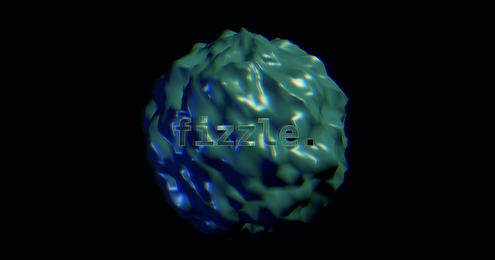

# fizzle

A livecoding environment for visual art. Chain operators into 2D and 3D scenes,
then run shader passes over the finished frame.



It runs in the browser at **[fizzle.glossing.dev](https://fizzle.glossing.dev)**,
with nothing to install to try it.

```js
ambient({ intensity: 0.3 })
directional({ intensity: 2.5 }).position(3, 4, 2).out()

sphere({ radius: 1.2, res: 96 })
  .position(0, t => Math.sin(t), 0)     // any number can be a fn of time
  .noise({ amp: 0.4, period: 0.5, octaves: 4, speed: 0.5 })
  .instance(60, (x, i) => x.position(Math.cos(i), 0, Math.sin(i)))
  .material({ color: '#4fd1c5', roughness: 0.3, metalness: 0.5 })
  .out()

scene().kaleido(6).bloom({ threshold: 0.6 }).out()
```

Chains read left to right and top to bottom; nothing appears until `.out()`.
Any numeric parameter can take a signal instead of a number: time, audio, or
the mouse.

The render loops back on itself. `scene()` hands the lit frame back as a
texture, so it can run through shader passes and then drive another mesh as a
color or displacement map. Particles emit from a point, a shape's surface, or
the bright pixels of a live texture.

## Install

Needs Node 18+ and a WebGL2 browser (Chrome/Edge for the optional local-font
and audio-output-device features).

```sh
npm install
npm run dev   # then open http://localhost:5173
```

Sketches you save go to `sketches/user/` as plain `.js` files you can open in
any editor. That folder is gitignored, so your sketches stay yours. The dev
server also proxies Google Fonts, which is what makes `font:` lookups work.

Both of those are dev-server features. If you serve a static build instead,
sketches fall back to localStorage and `font:` lookups are limited.

## Docs

**Interactive docs live at
[fizzle.glossing.dev/docs](https://fizzle.glossing.dev/docs)**, also reachable
from the "docs & reference ↗" link in the sidebar. Every example there is a
live editor running on a real engine in a preview panel, alongside a searchable
reference for the whole API. That's the place to learn what the operators do;
this README stays a starting point.

In the editor itself, autocomplete knows the entire API and carries signatures
and doc lines. `ctrl + hover` on any name pops the same docs.

## Keys

`ctrl + enter` run · `ctrl + .` pause/play · `ctrl + h` hide/show editor
(the projector's, while one is open) · `ctrl + m` hide/show this window's ·
`ctrl + p` sidebar · `ctrl + hover` docs for a command · drag to orbit, scroll
to zoom.

## Project layout

- [src/engine.js](src/engine.js) — renderer, scene/patch lifecycle, frame loop, sketch eval
- [src/api.js](src/api.js) — the chainable operator API
- [src/textures.js](src/textures.js) — texture shader passes, graph evaluation, feedback
- [src/noise.js](src/noise.js) — GLSL simplex fbm + shader injection
- [src/editor.js](src/editor.js) — CodeMirror overlay, keybindings, completions
- [src/docs.js](src/docs.js) — API docs table → autocomplete + ctrl+hover tooltips
- [src/docs-page.js](src/docs-page.js) + [src/docs-content.md](src/docs-content.md) — the interactive docs page ([docs.html](docs.html))
- [src/sidebar.js](src/sidebar.js) — settings + sketch palette
- [vite.config.js](vite.config.js) — dev-server API for `sketches/user/`
- [api/gfont/[family].js](api/gfont/[family].js) — the same Google Fonts proxy as a serverless function, for the hosted build
- [sketches/examples/](sketches/examples/) — bundled example sketches
- [dev-notes/](dev-notes/) — TODO list, deployment notes, scoping documents

## Credits

fizzle is built on [three.js](https://threejs.org). Almost everything that
reaches the screen is its renderer doing the work. Thanks to Ricardo Cabello
and the three.js contributors for the wonderful decade of it.

The livecoding model draws inspiration from
[Hydra](https://hydra.ojack.xyz) and from TouchDesigner. Neither project is
affiliated with this one.

Redistributed components and their licenses are listed in
[THIRD-PARTY-NOTICES.md](THIRD-PARTY-NOTICES.md).

## License

fizzle is licensed under the **GNU Affero General Public License v3.0**
(AGPL-3.0-only). See [LICENSE](LICENSE).

In plain terms: you can use it, study it, share it, and modify it freely. Make
whatever visuals you like with it and sell them. Your work is yours. The
license doesn't touch it. The one condition is on the *code*: if you distribute
a modified version, or run one as a network service, you have to make your
source available under the same license. This helps keep fizzle open for
artists and hobbyists while stopping anyone from quietly rolling it into a
closed, proprietary product.
